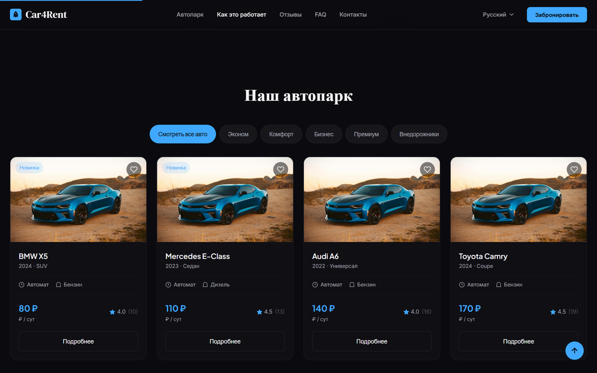

# Car4Rent Landing

**A fast, multilingual marketing site that keeps working when the API doesn't.**

## The Car4Rent system

| Repo | Role | Stack |
|---|---|---|
| **car4rent-backend** | REST API, auth, bookings, payments ledger, media | NestJS 11, TypeORM, PostgreSQL |
| **car4rent-mobile** | Customer and car-owner app (Android / iOS) | Expo / React Native, Redux Toolkit, TanStack Query |
| **car4rent-admin** | Back-office for managers | Refine 5, MUI 6, React Three Fiber |
| **car4rent-landing** | Public marketing site and lead capture | React 19, Vite, i18next, Framer Motion |

Car4Rent is a peer-to-peer and fleet **car rental platform** built as a diploma project: clients search
and book cars, owners publish and manage theirs, and managers run the whole thing from the admin panel.

<p align="center"></p>
<p align="center"></p>
<sub>Captured with the bundled mock data (the API was deliberately unreachable), which shows the offline fallback in action.</sub>

## Highlights

- **Sections for the whole story:** hero, how it works, why us, fleet preview with filters and a car
  detail modal, stats counters, locations map, reviews slider, FAQ, news, mobile-app promo, partnership
  call to action and a contact/lead form that creates rental leads in the API.
- **Multilingual by design.** i18next with the languages list coming from the API, an animated
  language switcher and per-entity translations.
- **Graceful fallback.** If the API is unreachable, the site switches seamlessly to bundled mock data
  instead of showing errors.
- **Polish:** Framer Motion animations, scroll progress bar, animated counters, brand marquee, mobile
  navigation.

## Stack

React 19, Vite 6, React Router 7, TanStack Query, i18next, Framer Motion.

## Run

```bash
cp .env.example .env     # VITE_API_URL points to the Car4Rent API (optional - mock data otherwise)
npm install
npm run dev
```